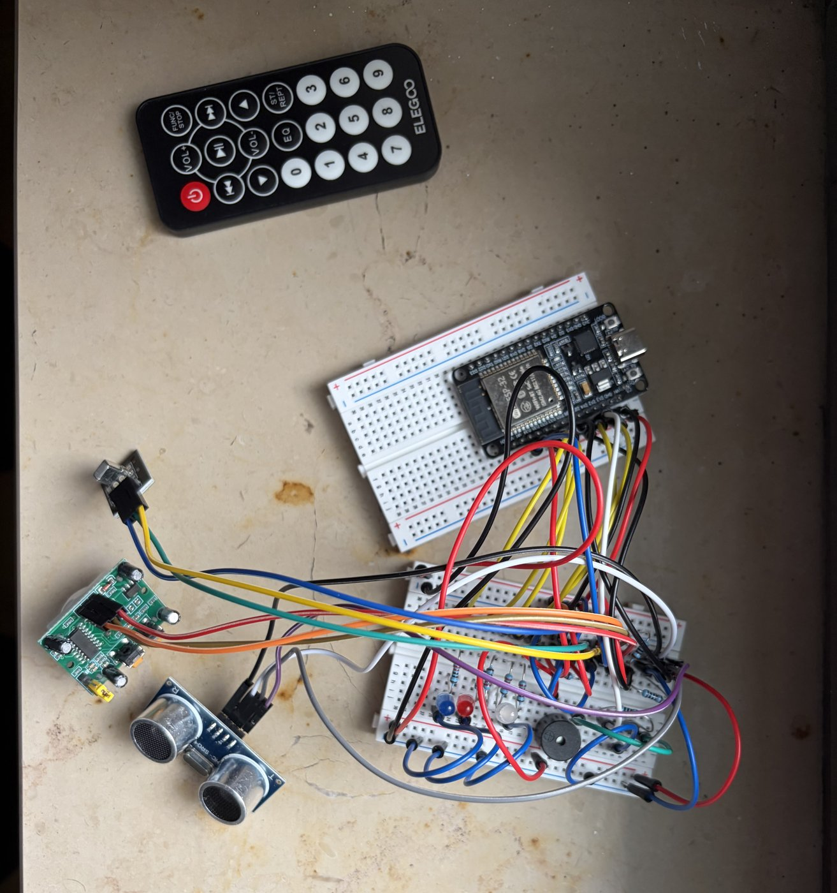
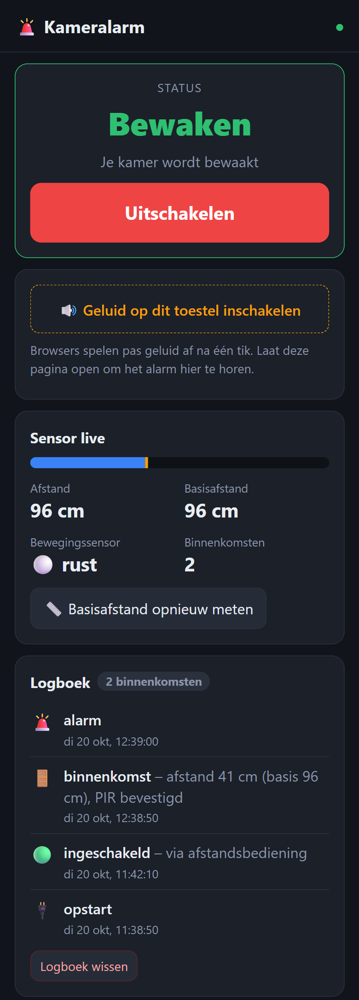
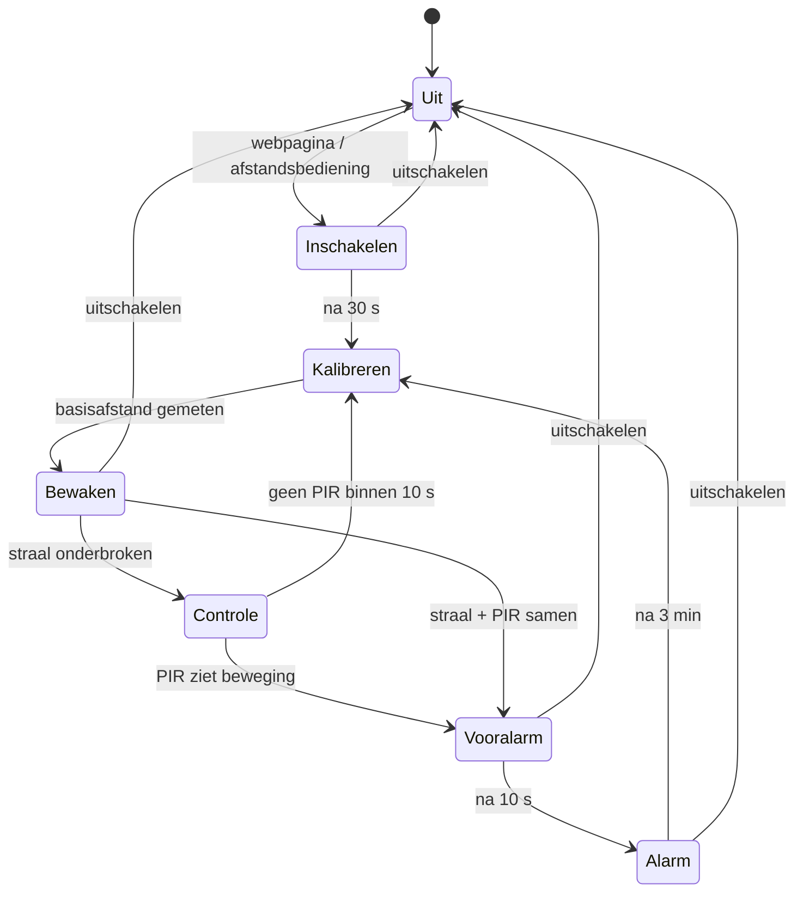
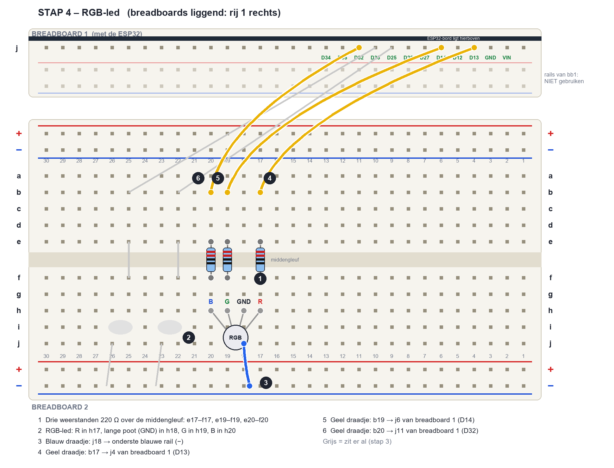

# 🚨 ESP32 Kameralarm


Een alarm voor je kamer, volledig gebouwd met de onderdelen uit **één starterset** (ELEGOO ESP32 Starter Kit) –
niets extra te kopen. Een **ultrasone "struikeldraad"** bij de deur en een **bewegingssensor** als tweede controle
detecteren wie binnenkomt. Het alarm knippert als een politieauto, speelt je **eigen mp3** af op je gsm, houdt een
**logboek** bij en stuurt een **pushmelding** naar je gsm.

<table>
  <tr>
    <td align="center" width="62%"><br><sub><b>Het eindresultaat</b> – volledig op breadboards, alleen onderdelen uit de starterset</sub></td>
    <td align="center" width="38%"><br><sub><b>De webpagina</b> op je gsm</sub></td>
  </tr>
</table>

## Functies

- 📏 **Ultrasone tripwire** – meet bij het inschakelen zelf de basisafstand en reageert op elke onderbreking van de straal
- 🔥 **PIR-bevestiging** – alarm alleen als ook de bewegingssensor iets ziet (minder vals alarm, uit te schakelen)
- ⏱️ **Vertrek- en vooralarm** – 30 s om weg te gaan, 10 s om uit te schakelen als jij het zelf bent
- 🚓 **Politie-effect** – rode en blauwe led om en om, RGB-led in een kleurenwiel, zoemer
- 📱 **Webpagina** voor gsm en pc – live status en afstand, aan/uit, instellingen, eigen mp3 uploaden
- 📒 **Logboek** – wanneer en hoe vaak iemand binnenkwam (bewaard bij stroomuitval)
- 🔔 **Pushmeldingen** via de gratis [ntfy](https://ntfy.sh)-app – geen account nodig
- 📡 **IR-afstandsbediening** – POWER schakelt het alarm aan/uit (andere knop aanleren kan)
- 🧪 **Testmodus** – elk onderdeel apart testen via de seriële monitor

## Hoe het werkt



| Toestand | Leds | Geluid |
|---|---|---|
| Inschakelen | blauw knippert traag | – |
| Bewaken | RGB "ademt" zacht groen | – |
| Vooralarm | rood/blauw rustig om en om | piepje per seconde |
| Alarm | snelle politieflitsen + kleurenwiel | zoemer, mp3/sirene op de webpagina, ntfy-melding |

## Onderdelen

Alles uit de **ELEGOO ESP32 Starter Kit** (EU-EHJ-KIT-032):

| Onderdeel | Aantal |
|---|---|
| ESP32-ontwikkelbord (30 pinnen, USB-C) | 1 |
| Breadboard 400 punten | 2 |
| Ultrasone sensor HC-SR04 | 1 |
| Bewegingssensor HC-SR501 (PIR) | 1 |
| IR-ontvanger + afstandsbediening | 1 |
| Led rood + led blauw | 2 |
| RGB-led (gemeenschappelijke kathode) | 1 |
| Actieve zoemer | 1 |
| NPN-transistor PN2222 | 1 |
| Weerstanden 220 Ω / 1 kΩ / 2 kΩ | 5 / 3 / 1 |
| Jumper wires + female-male draden | ±25 + 10 |

Voeding: een gewone gsm-lader (5 V) met USB-C-kabel.

## Bedrading

<p align="center">
  
</p>

| ESP32 | Onderdeel |
|---|---|
| D26 / D27 | HC-SR04 Trig / Echo (Echo via spanningsdeler 1 kΩ + 2 kΩ) |
| D34 | PIR-uitgang |
| D35 | IR-ontvanger (via 1 kΩ) |
| D25 / D33 | rode / blauwe led (via 220 Ω) |
| D13 / D14 / D32 | RGB rood / groen / blauw (via 220 Ω) |
| D12 | zoemer via PN2222 (basis via 1 kΩ) |
| VIN / GND | 5 V- en GND-rails |

📘 **Volledige stap-voor-stap-bouwgids met tekeningen:** [docs/Bouwgids-Kameralarm.pdf](docs/Bouwgids-Kameralarm.pdf)
– en als tekst: [docs/bedrading.md](docs/bedrading.md).

> ⚠️ De ESP32-pinnen verdragen **maximaal 3,3 V**. De spanningsdeler op Echo is verplicht.

## Installatie

1. **PlatformIO** installeren ([VS Code-extensie](https://platformio.org/install/ide?install=vscode) of `pip install platformio`).
2. Repository klonen:
   ```bash
   git clone https://github.com/yassir222736/esp32-room-alarm.git
   cd esp32-room-alarm
   ```
3. Persoonlijke instellingen aanmaken:
   ```bash
   cp include/secrets.example.h include/secrets.h
   ```
   Vul in `include/secrets.h` je wifi (**2,4 GHz**), een eigen **pincode** en een **lange willekeurige ntfy-topic** in.
   Dit bestand staat in `.gitignore` en wordt nooit gecommit.
4. Bord aansluiten en uploaden:
   ```bash
   pio run -t upload       # firmware
   pio run -t uploadfs     # webpagina (wist ook logboek, instellingen en mp3)
   pio device monitor      # toont het IP-adres
   ```
   Bord met een CP2102-chip? Installeer dan eerst de *CP210x Universal Windows Driver* van Silicon Labs.

## Gebruik

- **Webpagina:** `http://kameralarm.local` of het IP-adres uit de seriële monitor. Tik één keer op
  *Geluid inschakelen*, want browsers spelen pas geluid na een tik.
- **Meldingen:** installeer [ntfy](https://ntfy.sh) en abonneer je op je topic. Op Android kun je je mp3 instellen
  als meldingsgeluid.
- **Testen:** typ in de seriële monitor `t leds`, `t rgb`, `t buzzer`, `t sonar`, `t pir`, `t ir`, `t irpin` of `t alarm`
  (`help` toont alles). Zie [docs/bouwen-en-testen.md](docs/bouwen-en-testen.md).
- **Plaatsen:** zie [docs/plaatsing.md](docs/plaatsing.md).

Webpagina zonder ESP32 bekijken? Open `data/www/index.html` gewoon in je browser: die draait dan in testmodus
(pincode `1234`).

## Projectstructuur

```
├── include/
│   ├── config.h              # pinnen en standaardinstellingen
│   └── secrets.example.h     # sjabloon voor wifi, pincode, ntfy-topic
├── src/
│   ├── main.cpp              # opstart, wifi, testmodus
│   ├── alarm.cpp             # toestandsmachine
│   ├── sensors.cpp           # ultrasone sensor (mediaanfilter) + PIR
│   ├── effects.cpp           # leds, RGB, zoemer
│   ├── logbook.cpp           # logboek op LittleFS
│   ├── notify.cpp            # ntfy-pushmeldingen
│   ├── ir.cpp                # IR-afstandsbediening
│   ├── settings.cpp          # instellingen op LittleFS
│   └── web.cpp               # webserver, WebSocket, API
├── data/www/                 # webpagina (HTML/CSS/JS)
├── docs/                     # bouwgids (PDF), bedrading, plaatsing, testen
├── tools/                    # scripts voor de PDF, tekeningen en seriële tests
├── partitions.csv            # 2 MB app + ±1,9 MB bestandssysteem
└── platformio.ini
```

## Veiligheid & beperkingen

Dit is een **hobbyproject**, geen gecertificeerd alarmsysteem.

- De webpagina werkt alleen op je **lokale netwerk**, via gewone **HTTP** (geen HTTPS). Iedereen op hetzelfde wifi
  kan de status zien; bedienen, instellingen en het logboek vragen de **pincode**.
- De pincode is een drempel tegen huisgenoten, geen sterke beveiliging. Na **5 foute pogingen** blokkeert de
  webpagina **1 minuut**.
- ntfy-meldingen gaan via de openbare server `ntfy.sh`. **Wie je topic kent, kan je meldingen lezen** – kies dus een
  lange, willekeurige naam. De inhoud van de melding is niet geheim.
- Stel het alarm nooit open naar het internet (geen port-forwarding).
- Een stroomonderbreking of een uitgetrokken kabel schakelt het alarm uit.

## Bekende problemen

- **IR-ontvanger reageert niet:** test de afstandsbediening met een gsm-camera (je ziet paars licht). Toont
  `t irpin` geen enkele wisseling en knippert lampje "L" op de module niet, dan is de module waarschijnlijk defect.
  Het alarm werkt volledig zonder afstandsbediening via de webpagina.
- **Geen pulldown op de IR-lijn:** een spanningsdeler zoals bij de HC-SR04 trekt het zwakke IR-signaal volledig
  naar beneden. Gebruik alleen 1 kΩ in serie.

## Licentie

[MIT](LICENSE) – vrij te gebruiken, aan te passen en te delen.
